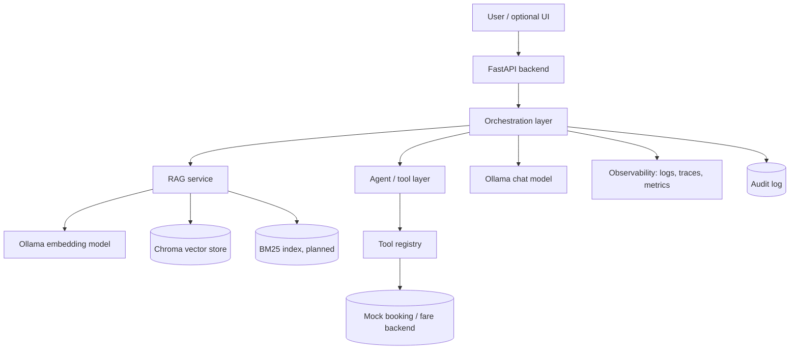
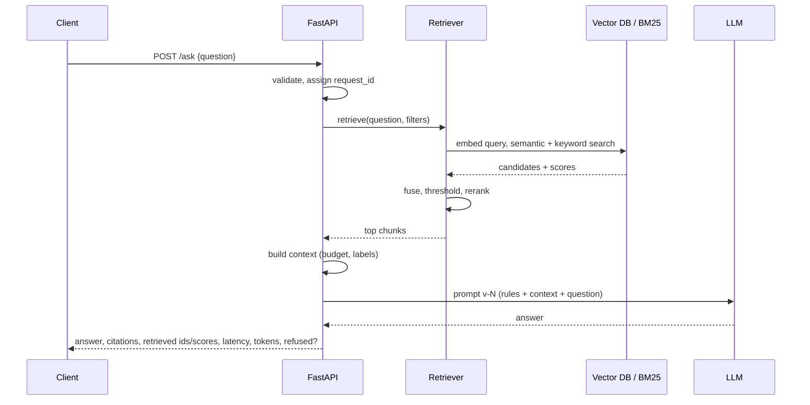
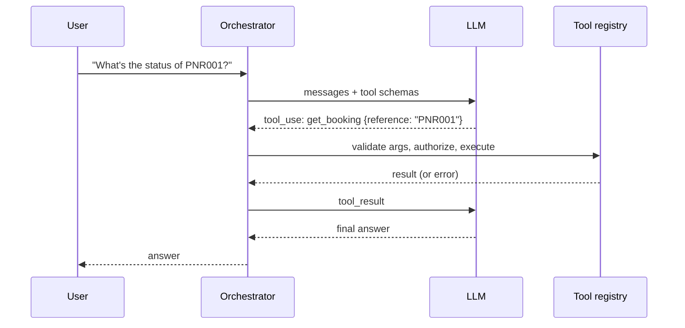
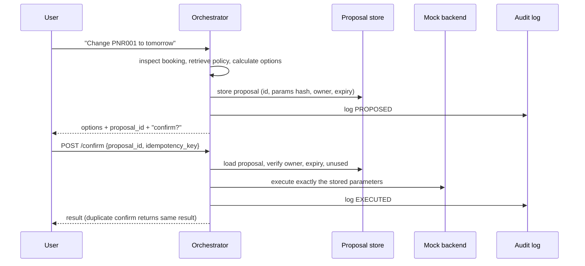

# Travel RAG: Architecture

> Learning project; all travel data is synthetic. This document describes the target design. The sibling `plan.md` is the source of truth for milestone order and progress.

## 1. Purpose and scope

An AI assistant for travel sellers that can:
1. Answer policy questions grounded in a document corpus (**RAG**).
2. Look up booking data and compute change options via **tools** against a mock backend.
3. Propose consequential actions that require **human confirmation** before execution.
4. Be **evaluated** and **observed** end to end.

Non-goals: model training, fine-tuning, multi-agent frameworks, production deployment on real systems, real passenger data.

## Current implementation and technology

The current checkpoint provides basic API routes and a chat endpoint, but is
not yet a RAG pipeline:

- The application lives in `travel_rag/app/`; `travel_rag/app/main.py` creates the FastAPI app and includes the router.
- `travel_rag/app/api/routes.py` provides `GET /`, `GET /health`, and `POST /chat`.
- The chat route validates requests, calls a shared async Ollama client, and returns the answer, request ID, latency, and token counts. Validation, upstream failures, and timeouts map to HTTP 422, 502, and 504.
- Route behavior is covered by pytest tests under `travel_rag/tests/`, using a fake chat client for deterministic tests.
- The current declared packages are listed in `travel_rag/requirements.txt`. Pydantic and pydantic-settings are used for API contracts and configuration.
- Ollama is integrated for chat with `llama3:8b` as the current default model. No embedding model has been selected.
- No vector store, ingestion pipeline, retrieval layer, agent, or orchestration framework is currently implemented.

The planned learning stack is Python + FastAPI/Pydantic, local Ollama for chat
and embeddings, Chroma as the initial vector store, and pytest. The roadmap
adds BM25/hybrid retrieval later. Embedding and vector-store details must be
verified and recorded when those milestones are reached. Follow the roadmap's
gate on orchestration frameworks: implement the mechanics directly through
Day 9 before considering a framework.

## 2. Vocabulary (be precise in interviews)

| Term | Meaning in this system | Example |
|---|---|---|
| **RAG** | Retrieve knowledge, put it in the prompt, generate a grounded answer | "What is the baggage allowance?" |
| **Tool** | A function our code exposes; the model *requests* it, our code *executes* it | `get_booking("PNR001")` |
| **Agent** | LLM-driven loop that decides which capability to use next | Open-ended multi-step request |
| **Workflow** | Fixed or semi-fixed control flow written in code | get booking -> retrieve policy -> calculate -> compose |
| **HITL** | Human approval gate before a consequential tool executes | Confirm change request |

## 3. System context

The diagram below is the planned end state, not the current runtime path. Today, requests go through Uvicorn to FastAPI and the implemented root/health routes; there is no LLM, RAG, or tool call in the application.



## 4. Component responsibilities

| Component | Responsibility | Key design notes |
|---|---|---|
| API layer (`travel_rag/app/main.py`, `travel_rag/app/api/`) | Current: FastAPI app and root/health routes. Planned: request validation and error mapping. | Pydantic is used for API response models; auth is not implemented |
| Configuration (`travel_rag/app/config.py`) | Typed Ollama URL, model, and timeout settings | Environment prefix is `TRAVEL_RAG_` |
| LLM client (`travel_rag/app/llm/`) | Async calls to local Ollama, timeouts, errors, and token usage | Shared HTTP client is created and closed in FastAPI lifespan |
| Ingestion (planned) | Extract, clean, chunk, attach metadata, embed, and index | Make indexing repeatable and versioned |
| Retrieval (planned) | Semantic retrieval first; add BM25/hybrid search at the planned milestone | Evaluate rather than assume quality |
| Reranker (future/optional) | Re-score top-N candidates | Only add if evaluation justifies latency/cost |
| Context builder (planned) | Select, order, label, and budget chunks | Controls prompt size and citation labels |
| Tool registry (planned) | Tool schemas, validation, and execution | Reject unknown tools; enforce permissions |
| Agent loop (planned) | Iterate LLM <-> tools with guards | `MAX_TOOL_CALLS`, deadline, repeat detection |
| Proposal store (planned) | Holds pending consequential actions | ID, expiry, parameter hash, owner |
| Audit log (planned) | Immutable record of proposed/confirmed/executed actions | Who, what, when, outcome |
| Observability (planned) | Per-request trace and metrics | Add request IDs, per-stage latency, tokens, chunks, and tool calls at the planned milestone |
| Eval harness (planned) | Retrieval, generation, agent, and operational metrics | Baseline and regression comparisons |

## 5. Request flows

### 5.1 RAG request



If no chunk clears the threshold, the system returns an explicit "insufficient evidence" outcome and skips (or constrains) generation.

### 5.2 Tool-calling request (single tool)



Key point: the model only *requests* the call. The orchestrator validates and executes.

### 5.3 Agent loop

```
state = {messages, tool_call_count, call_history, deadline}
loop:
    if tool_call_count >= MAX_TOOL_CALLS or now > deadline: stop with partial/failed result
    response = LLM(state.messages, tool_schemas)
    if response is final text: return it
    for each requested tool call:
        if tool unknown or args invalid: append error observation; continue
        if identical call already made: append "duplicate call" observation; continue
        if tool is consequential: create proposal; stop and ask user to confirm
        result = execute(tool, args)       # with timeout
        append observation; tool_call_count += 1
```

### 5.4 Human-in-the-loop change request



### 5.5 Combined RAG + tools (target query)

"I need to change PNR001 to tomorrow. What does the policy allow and what options do I have?"

Workflow baseline:
1. `get_booking(PNR001)` -> fare class, date, status
2. RAG over ticket-change/cancellation policies, filtered by fare class where possible
3. `calculate_change_options(booking, new_date)`
4. LLM composes answer with policy citations + options
5. If user wants to proceed -> HITL flow (5.4)

The agentic variant lets the model choose and order steps 1-3. Day 11 compares the two on accuracy, latency, cost, variance, and debuggability.

## 6. Data model (sketch)

```
Chunk:        id, doc_id, title, section, text, chunk_index, version, effective_date, acl_tags
RetrievalHit: chunk_id, score, source(semantic|bm25|fused|rerank), rank
ToolSpec:     name, description, args_schema, permission, consequential: bool
Proposal:     id, owner, tool, args, args_hash, status, created_at, expires_at, idempotency_key
Trace:        request_id, query, prompt_version, model, hits[], tool_calls[], timings{}, tokens{}, outcome, error
AuditEvent:   ts, actor, request_id, action, proposal_id, outcome
```

## 7. Key design decisions (summary; full ADRs go in `decisions.md`)

| # | Decision | Rationale | Alternatives / trade-off |
|---|---|---|---|
| 1 | Implement core mechanics directly through Day 9 | Learn the flow and keep it debuggable | Consider a framework only after the roadmap gate and a concrete need |
| 2 | Own retry policy; SDK retries off | Retries must be safe for state-changing operations | SDK default retries are convenient but opaque |
| 3 | Hybrid retrieval (planned) | Embeddings miss exact codes/IDs; BM25 misses paraphrase | Complexity and tuning cost |
| 4 | Workflow first, agent where justified | Reliability, cost, testability | Agents flexible but variable and costlier |
| 5 | Propose -> confirm -> execute for mutations | Prevent unauthorized or injected actions | Extra user step |
| 6 | Citations required; refusal on weak evidence | Reduce hallucination, enable auditing | May over-refuse; tune with eval |
| 7 | Versioned prompts logged per request | Reproducibility and regression analysis | Slight process overhead |
| 8 | Chroma is the planned initial local vector store | Fast to start for learning; not yet integrated | pgvector (SQL + ACL joins) / Qdrant (scale, filters) if future requirements justify a change |

## 8. Failure modes and handling

| Failure | Detection | Handling |
|---|---|---|
| LLM timeout | Client timeout | Bounded retry if safe; else 504 with request_id |
| LLM 429 / throttling | Status code | Backoff with jitter; surface 503 if exhausted |
| Malformed LLM output | Schema validation | Reprompt once with error; else fail clearly |
| Vector DB down | Exception / health check | 503; never fall back to ungrounded answers silently |
| Retrieval returns nothing relevant | Threshold | Explicit "insufficient evidence" |
| Tool error | Exception / non-2xx | Return error observation; cap retries |
| Infinite agent loop | Counters, repeat detection | Hard stop with partial result |
| Duplicate confirm | Idempotency key | Return original result, no re-execution |
| Confirm times out client-side | Idempotency + status lookup | Safe to retry; query proposal status |
| Stale policy | `effective_date`, `version` metadata | Filter to current; flag in answer |

## 9. Security model

| Threat | Mitigation |
|---|---|
| Direct prompt injection | System/user separation, input limits, output validation, tool authorization in code |
| Indirect injection (poisoned docs/tool output) | Treat retrieved content as data, delimit, never grant it authority; HITL for mutations |
| Cross-user data leakage | ACL filters applied at retrieval time; per-user cache keys; no shared conversational memory across users |
| Unauthorized tool use | Per-tool permissions checked against caller identity, not model output |
| Parameter tampering on confirm | Execute stored proposal only; verify parameter hash |
| PII exposure | Synthetic data here; in production redact before logging/LLM where possible |
| Secret leakage | Key Vault/Secrets Manager; `.env` git-ignored; no secrets in logs |
| Excess consumption / cost abuse | Rate limits, token budgets, loop caps, per-tenant quotas |
| Repudiation | Immutable audit log tied to request_id and actor |

## 10. Observability and evaluation

**Per-request trace:** `request_id`, query, prompt version, model, retrieved chunk IDs + scores, tool calls (name, args, latency, outcome), per-stage latency (embed, retrieve, rerank, LLM, total), token usage, failures.

**Metrics**
- Retrieval: Hit@K, Precision@K, Recall@K, MRR
- Generation: correctness, relevance, groundedness/faithfulness, refusal accuracy
- Agent: tool selection accuracy, argument correctness, unnecessary calls, task success
- Operational: p50/p95 latency, failure rate, tokens per request, cost per request

**Process:** Baseline -> change one variable -> re-run eval -> compare -> record in `decisions.md`.

## 11. Enterprise-scale considerations (to be completed on Day 13)

- **Scalability:** stateless API pods behind a load balancer; externalize proposals/sessions/traces; queue-based ingestion; streaming responses; embedding and retrieval caches (key by tenant and ACL scope); managed vector DB with replicas.
- **Reliability:** circuit breakers around LLM and vector DB; fallback model; graceful degradation; idempotent writes; dead-letter queue for failed ingestion; timeouts at every hop.
- **Security:** SSO/OIDC authN, role/attribute-based authZ, document-level ACLs, secrets management, egress controls, audit retention.
- **Cost:** token budgets and context trimming, model routing by task difficulty, caching, reranker candidate limits, agent step caps, batch embedding, per-tenant quotas and dashboards.
- **Governance:** prompt/model version control, evaluation gates in CI, change approval, rollback plan, incident process.

## 12. Open questions (answer as the build progresses)

- What chunk size/overlap performed best on my eval set, and why?
- Which retrieval technique gave the largest gain, and where did it hurt?
- Did the agentic variant beat the workflow on any metric that matters?
- Where is the weakest security boundary today?
- What would change for 1,000 requests/second and multiple tenants?
