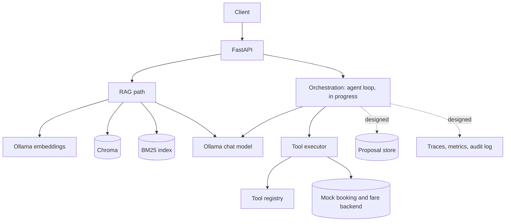
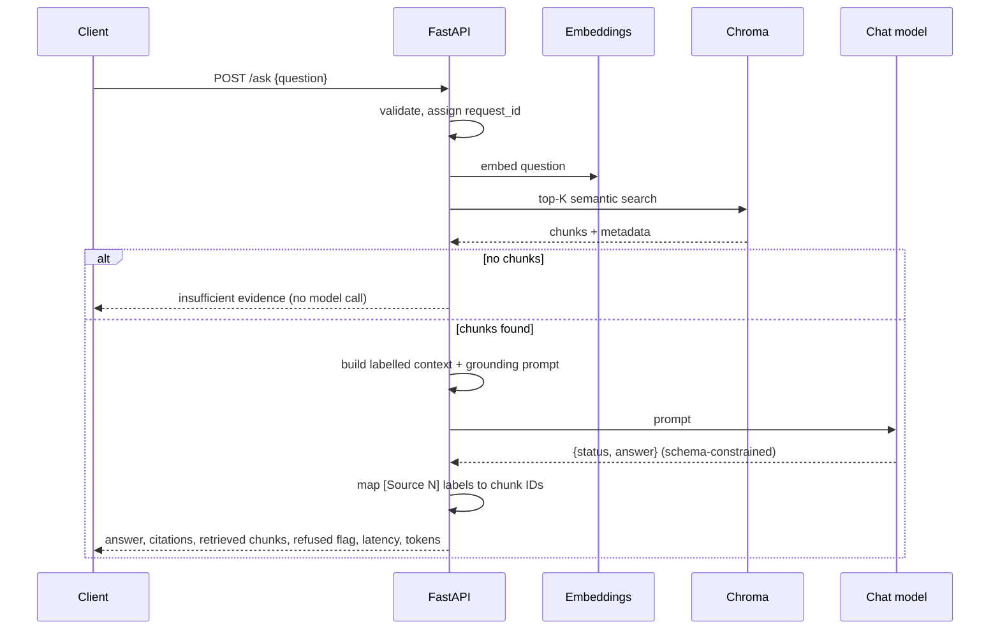

# Travel RAG: Architecture

> All travel, policy, booking and passenger data is synthetic. Sections marked
> **Designed** describe the target and are not implemented yet; everything else
> describes the code as it is.

## 1. Purpose and scope

An assistant for travel sellers that can:

1. Answer policy questions grounded in a document corpus, with citations (**RAG**).
2. Look up bookings and quote change options through **tools** against a mock backend.
3. Propose consequential actions that require **human confirmation** before execution.
4. Be **evaluated** and **observed** end to end.

Non-goals: model training or fine-tuning, multi-agent frameworks, real passenger
data, flight- or safety-critical functions.

## 2. Vocabulary

| Term | Meaning in this system | Example |
|---|---|---|
| **RAG** | Retrieve knowledge, put it in the prompt, generate a grounded answer | "Must my personal item fit under the seat?" |
| **Tool** | A function the application exposes; the model *requests* it, application code *executes* it | `get_booking("PNR001")` |
| **Agent** | A model-driven loop that decides which capability to use next | An open-ended, multi-step request |
| **Workflow** | Control flow fixed in code | get booking → retrieve policy → quote → compose |
| **Human in the loop** | A person approves a consequential action before it runs | Confirm a change request |

## 3. System context



## 4. Components

| Component | Location | Responsibility | State |
|---|---|---|---|
| API | `app/main.py`, `app/api/routes/` | `/health`, `/chat`, `/ask`, `/chunkertest`; Pydantic request and response models; 422 / 502 / 504 error mapping | Built |
| Configuration | `app/config.py` | Typed settings with the `TRAVEL_RAG_` prefix | Built |
| Chat client | `app/llm/` | Async Ollama calls with timeouts and token usage; one shared HTTP client created and closed in the FastAPI lifespan | Built |
| Ingestion | `app/ingestion/` | Load Markdown policies; fixed-size and heading-aware chunking; embed and upsert with stable IDs | Built |
| Embeddings | `app/embeddings/` | Ollama `nomic-embed-text` (768 dimensions) | Built |
| Vector store | `app/vector_store/` | Persistent Chroma collection | Built |
| Retrieval | `app/retrieval/` | Semantic top-K; BM25; Reciprocal Rank Fusion; retrieval metrics | Built; hybrid not yet used by `/ask` |
| Context and prompt | `app/rag/` | Ordered, source-labelled context; grounding and untrusted-data instructions; citation mapping from labels to chunk IDs | Built |
| Evaluation | `eval/`, `scripts/` | Labelled dataset; per-case and aggregate Hit@K, Precision@K, Recall@K, MRR; strategy comparison | Built for retrieval; generation scoring designed |
| Tool registry | `app/tools/registry.py`, `app/tools/schemas.py` | One `ToolSpec` per tool: name, model-facing description, argument model, function | Built |
| Tool executor | `app/tools/executor.py` | Reject unknown tools; validate arguments; run with the caller's identity; return errors as observations | Built |
| Mock backend | `app/mock_backend/` | Bookings with owners; fare codes, change-fee bands, fares; owner check on every lookup | Built |
| System prompt | `app/agent/prompts.py` | Server date, currency, ask-don't-guess, report credits and notes | Built |
| Agent loop | `app/agent/` | Repeat model → tools → observations with a step limit, a deadline and repeated-call detection | In progress |
| Proposal store | | Pending consequential actions: ID, owner, exact parameters and their hash, expiry, idempotency key | Designed |
| Observability and audit | | Per-request trace; immutable record of proposed, confirmed and executed actions | Designed |

## 5. Request flows

### 5.1 RAG request (`POST /ask`)



Citations are mapped from the answer's source labels to the retrieval order, so
the response never trusts metadata the model repeats. The `refused` flag comes
from the model's structured `status`; it is a self-report, not a verified
grounding check.

### 5.2 Tool call

```mermaid
sequenceDiagram
    participant U as User
    participant O as Orchestrator
    participant L as Chat model
    participant X as Executor
    participant B as Mock backend
    U->>O: "What would it cost to move PNR001 to 2026-11-21?"
    O->>L: system prompt + messages + tool schemas (from the registry)
    L-->>O: tool_call quote_change {reference, new_date}
    O->>X: execute_tool(name, arguments, user_id)
    X->>X: known tool? arguments valid? (Pydantic, extra=forbid)
    X->>B: calculate_change_options(reference, new_date, user_id)
    B->>B: load booking; owner check; quote
    B-->>X: ChangeQuote
    X-->>O: JSON observation (or an error string)
    O->>L: messages + tool result
    L-->>O: final answer
    O-->>U: answer
```

The model only requests the call. Identity is supplied by application code; the
argument models reject a model-supplied `user_id`. A booking that does not exist
and a booking that belongs to someone else return the same message.

### 5.3 Agent loop (in progress)

```text
state = {messages, tool_call_log, started_at}
loop:
    if tool calls >= MAX_TOOL_CALLS or elapsed > DEADLINE: stop with a safe message
    reply = model(state.messages, tool_schemas)
    if reply has no tool calls: return reply
    for each requested call:
        if the same (name, arguments) was already called: observation = "duplicate call"
        else: observation = execute_tool(...) under a per-tool timeout
        append observation; record the step
```

Parallel tool calls in one reply are supported by the executor today; the loop
adds the guards and the trace.

### 5.4 Human approval for a change (designed)

```mermaid
sequenceDiagram
    participant U as User
    participant O as Orchestrator
    participant P as Proposal store
    participant B as Mock backend
    participant AU as Audit log
    U->>O: "Change PNR001 to 2026-11-21"
    O->>O: load booking, quote the change
    O->>P: store proposal (id, owner, parameters, hash, expiry)
    O->>AU: PROPOSED
    O-->>U: quote + proposal_id + "confirm?"
    U->>O: POST /confirm {proposal_id, idempotency_key}
    O->>P: load stored proposal; verify owner, expiry, unused
    O->>B: execute exactly the stored parameters
    O->>AU: EXECUTED
    O-->>U: result (a repeated confirm returns the same result)
```

The model can produce a proposal but never execute one. Confirmation executes
the stored proposal, not parameters the client resends.

### 5.5 Combined RAG and tools (target)

"I need to change PNR001 to tomorrow. What does the policy allow and what are my
options?"

Workflow version: get the booking → retrieve the ticket-change policy for its
fare class → quote the change → compose an answer with policy citations and the
quote → if the user wants to proceed, the approval flow above. An agentic
version lets the model choose and order those steps; the two are to be compared
on accuracy, latency, cost, run-to-run variance and debuggability.

## 6. Data model

Implemented:

```text
Chunk:        id (source:index), text, source, chunk_index, section
Booking:      reference, owner_id, passenger_name, origin, destination, departure_date, fare_class, status
ToolSpec:     name, description, args_model, func
FareRules:    reference, fare_code, fare_type, changeable, condition
ChangeQuote:  reference, new_date, changeable, reason, change_fee, old_fare, new_fare,
              fare_difference, credit_issued, credit_valid_months, total_to_pay, currency, notes
```

Designed:

```text
Proposal:     id, owner, tool, args, args_hash, status, created_at, expires_at, idempotency_key
Trace:        request_id, prompt_version, model, hits[], tool_calls[], timings{}, tokens{}, outcome, error
AuditEvent:   ts, actor, request_id, action, proposal_id, outcome
```

## 7. Key decisions

Full records with evidence are in [decisions.md](decisions.md).

| Decision | Rationale | Trade-off |
|---|---|---|
| Hand-build the request path, evaluation, trust boundary and agent loop; use libraries for commodity parts | These are the mechanisms that decide correctness and safety, and they stay debuggable | More code to own than adopting a framework |
| No automatic retries on model calls; retry policy is the application's decision | Retries must be safe once tools change state | Transient failures surface as errors today |
| Hybrid retrieval (semantic + BM25, RRF) | Each method recovered cases the other missed on the eval set | A second index and a fusion step |
| Identity outside every tool schema; authorization in the data layer | The model cannot claim to be someone else; a new tool cannot skip identity | Each tool must still apply the check |
| Facts the answer needs go into the tool result | The model reads the result, not the tool list, when it writes the answer | Larger results |
| Workflow first, agent where justified | Reliability, cost and testability | Less flexibility for open-ended requests |
| Propose → confirm → execute for changes | No change happens from model text alone | An extra step for the user |
| Citations required; explicit refusal when evidence is missing | Fewer unsupported answers; auditable | Can over-refuse |
| Chroma as the local vector store | Fast to start, persistent, simple | pgvector or a managed store for ACL joins and scale |

## 8. Failure modes

| Failure | Detection | Handling |
|---|---|---|
| Model timeout | Client timeout | 504 with the request ID |
| Model service error | HTTP error | 502 with the request ID |
| Malformed structured output | Schema validation | 502; no unvalidated answer is returned |
| Retrieval returns nothing | Empty result | Insufficient-evidence response, no model call |
| Invented or malformed tool arguments | Pydantic validation | Error observation; the model can correct or ask the user |
| Unknown tool requested | Registry lookup | Error observation |
| Tool raises | Executor | Generic message to the model; full error logged |
| Final answer omits or changes tool facts | Observed in runs | Facts carried as data in the result; prompt rules; a code-level check is the designed fix |
| Agent loops or stalls | Step limit, deadline, duplicate detection | Stop with a safe message (in progress) |
| Duplicate or late confirm | Idempotency key, proposal status | Return the original result (designed) |

## 9. Security model

| Threat | Mitigation |
|---|---|
| Prompt injection in the question | System/user separation, input limits, output validation, authorization in code |
| Injection from retrieved documents | Retrieved text is labelled as untrusted data and never given authority; a test document contains an injected instruction |
| Model reads another user's booking | Owner check in the data layer; identity from application code only |
| Probing which bookings exist | Same message for "not found" and "not yours" |
| Internal error details reaching the model | Generic failure message; details only in logs |
| Unauthorized change | No tool can change a booking; changes require a confirmed stored proposal (designed) |
| Parameter tampering at confirm | Execute the stored proposal only and verify its hash (designed) |
| Secrets | `.env` is git-ignored; no secrets in code or logs |
| Cost abuse | Step limits and deadlines in the loop; rate limits and token budgets in production |

## 10. Observability and evaluation

**Built:** request IDs, latency and token usage on chat responses; a labelled
retrieval dataset with per-case and aggregate metrics; scripts that compare
semantic, BM25 and hybrid retrieval and that print every message of a
tool-calling run.

**Designed:** a per-request trace (prompt version, retrieved IDs and scores,
tool calls with arguments, timings and outcomes); generation metrics
(correctness, groundedness, refusal accuracy); agent metrics (tool-selection
accuracy, argument correctness, unnecessary calls, task success); and a
regression run on every change: baseline, change one variable, re-run, compare,
record the decision.

## 11. Production considerations

- **Scalability:** stateless API instances behind a load balancer; proposals,
  sessions and traces in external stores; queue-based ingestion; streaming
  responses; embedding and retrieval caches keyed by tenant and access scope; a
  managed vector store with replicas.
- **Reliability:** timeouts at every hop; circuit breakers around the model and
  vector store; a fallback model; idempotent writes; a dead-letter queue for
  failed ingestion.
- **Security:** SSO / OIDC authentication; role- or attribute-based
  authorization; document-level access control applied at retrieval time;
  managed secrets; egress controls; audit retention.
- **Cost:** token budgets and context trimming; routing by task difficulty;
  caching; loop step caps; batch embedding; per-tenant quotas.
- **Governance:** versioned prompts and models; evaluation gates in CI; change
  approval and rollback.

## 12. Open questions

- Which chunking strategy and size perform best on the eval set, beyond the
  section-versus-fixed comparison?
- Does wiring hybrid retrieval into `/ask` improve the answers, not only the
  retrieval metrics?
- Does the agentic variant beat the fixed workflow on any metric that matters for
  booking changes?
- What is the weakest security boundary today?
- What changes at 1,000 requests per second and many tenants?
